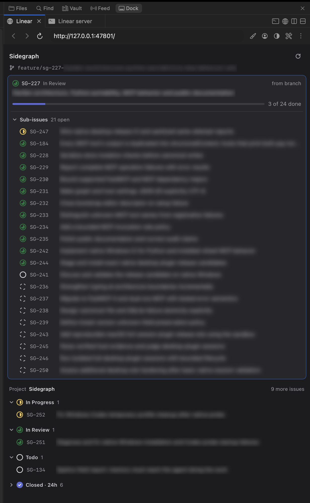

# Linear sidebar for cmux

See the Linear issues of the project you are working on, right next to your
terminals, in the [cmux](https://cmux.com) Dock.

<p align="center">
  
</p>

- **Your current issue**, found from the git branch name (like
  `abc-123-fix-login`), with its parent issue, its open sub-issues and a
  progress bar.
- **The project's board**: In Progress, In Review, Todo, the issues closed
  in the last 24 hours, and the 100 newest issues in the backlog, with a link
  to the rest in Linear. The project line counts its open issues and its
  backlog, like `19 open · 103 backlog`.
- **It follows you**: select another workspace in cmux and the sidebar switches
  to that project.
- Click an issue to open it in your browser.

## What you need

- A Mac with [cmux](https://cmux.com) 0.65.0 or newer
- A [Linear](https://linear.app) account
- Apple's command line tools, which provide `git` and Python. If you are not
  sure you have them, run `xcode-select --install` in a terminal: it either
  installs them or tells you they are already there.

## Install

1. Open a terminal **inside cmux**.
2. Paste these two lines and press Enter:

   ```sh
   git clone https://github.com/SantyagoSeaman/cmux-linear-sidebar.git ~/.cmux-linear-sidebar
   ~/.cmux-linear-sidebar/install.sh
   ```

3. The installer asks for a Linear API key. Create one in Linear under
   **Settings → Security & access → Personal API keys**, copy it, paste it into
   the terminal (it stays hidden while you paste) and press Enter. The installer
   checks the key and saves it in your Mac's Keychain.
4. The sidebar opens on the right, in the cmux **Dock**, as the **Linear** tab.

The first time, the installer also asks for one step in cmux, so that the
sidebar comes back by itself after cmux restarts:

1. In the Dock, click the **Linear server** tab.
2. Right-click inside it and choose **Resume Commands → Edit**, then save
   without changing anything.
3. In the **Allow Resume Command?** prompt, choose **Auto-Restore**.
4. Click the **Linear** tab to get back to your issues.

cmux asks you rather than letting a script do this, because it allows a
command to run automatically whenever cmux starts.

## How it finds your issues

For the workspace selected in cmux, the sidebar looks for:

1. **The current issue.** Linear recognizes the issue ID in the branch name.
   Branches made with Linear's *Copy git branch name* button work, and so do
   your own names that contain the ID, like `abc-123-login`. A workspace named
   after an issue, like `ABC-123`, works too.
2. **The project.** That is the current issue's project. On a branch without an
   issue, such as `main`, it is the Linear project that links to the
   repository: open the project in Linear and add the repository's GitHub
   address (`https://github.com/<owner>/<repo>`) under **Resources**. Failing
   that, it is the project of an issue that has this branch's pull request
   attached, if cmux shows a pull request for the workspace.

When nothing matches, the sidebar says why and how to connect the workspace.

## Update

```sh
git -C ~/.cmux-linear-sidebar pull
~/.cmux-linear-sidebar/scripts/dock-setup.sh --restart
```

The second command restarts the server in its Dock tab, so it runs the new
version.

## Uninstall

```sh
~/.cmux-linear-sidebar/uninstall.sh
rm -rf ~/.cmux-linear-sidebar
```

The first command stops the sidebar, closes its Dock tabs and removes the API
key from your Keychain.

## Troubleshooting

**The Linear tab says the sidebar server is not running.** In a cmux terminal,
run `~/.cmux-linear-sidebar/scripts/dock-setup.sh`. If this happens after every
cmux restart, repeat the one-time Auto-Restore step from [Install](#install).

**The Linear tab is gone.** Run `~/.cmux-linear-sidebar/install.sh` again: it
keeps your key and only reopens what is missing.

**"Linear rejected the API key".** The key was revoked or deleted. Create a new
one and run `~/.cmux-linear-sidebar/install.sh --new-key`. It saves the key and
restarts the server, which reads the key when it starts.

**"Can't read the Linear API key".** The login Keychain is locked, or macOS is
waiting for you to allow access. Unlock it when macOS asks, then click
**Try again** in the Linear tab.

**"No Linear project for …".** See [How it finds your issues](#how-it-finds-your-issues).

**An error that mentions certificates.** Python from python.org needs its
certificates installed: open `/Applications/Python 3.x/` and run
*Install Certificates.command*.

**The page shows a browser toolbar.** That is cmux's browser bar. To hide it,
add the browser control from [`dock.json.example`](dock.json.example) to
`~/.config/cmux/dock.json`, reload the Dock config from the Dock's menu, and
run `~/.cmux-linear-sidebar/scripts/dock-setup.sh`.

**Several cmux windows.** The sidebar follows the workspace that cmux reports as
selected, so every window's Dock shows the same issues.

## Privacy and security

- The API key is stored only in your macOS Keychain, under the name
  `cmux-linear-sidebar`. If you start the server yourself with
  `LINEAR_API_KEY` set, it uses that key instead and never stores it.
- The sidebar only reads from Linear; it never changes your issues.
- The local server listens on `127.0.0.1` only, refuses requests made under
  other host names, and takes actions only from its own page, so other
  websites cannot use it.
- To know where you are, it asks cmux which workspace is selected and reads the
  branch and `origin` remote with `git`.

## Settings

Environment variables, for advanced use:

| Variable | Default | |
| --- | --- | --- |
| `LINEAR_SIDEBAR_PORT` | `47801` | the port of the local server and of the Dock page |
| `LINEAR_SIDEBAR_REFRESH_SECONDS` | `60` | how often Linear is asked for changes |
| `LINEAR_API_KEY` | (the Keychain key) | use this key instead of the Keychain one |

Set the first two when you run `install.sh` or `scripts/dock-setup.sh`, for
example `LINEAR_SIDEBAR_PORT=47802 ~/.cmux-linear-sidebar/install.sh`. The
script passes them to the server as `--port` and `--refresh-seconds`, also in
the command cmux uses to restart it. With another port, change the port in the
`dock.json` browser control too, if you use one. `LINEAR_API_KEY` applies only
when you start `cmux-linear-sidebar` yourself: the scripts never put the key
on a command line.

## How it works

A small Python program runs in the **Linear server** tab of the Dock, asks cmux
which workspace is selected, reads its git branch, queries the Linear API, and
serves the page you see in the **Linear** tab. The details, including the cmux
behaviour it depends on, are in [docs/architecture.md](docs/architecture.md).

It asks Linear only while the Linear tab is open, and about once a minute for
the selected workspace. Switching workspaces shows each one's last view at
once, and the workspaces of one project, such as several branches of one
repository, share its issues, so moving between them adds little.

To run the tests:

```sh
python3 -m unittest discover -s tests -t .
```

## License

[MIT](LICENSE)

## Built with Sidegraph

This project is developed with [Sidegraph](https://github.com/SantyagoSeaman/sidegraph),
decision memory for AI coding agents. The design decisions behind the sidebar, the
alternatives that were dropped, and the cmux and Linear behaviour learned along the way
are kept in `.sidegraph/`, anchored to the code they are about.
